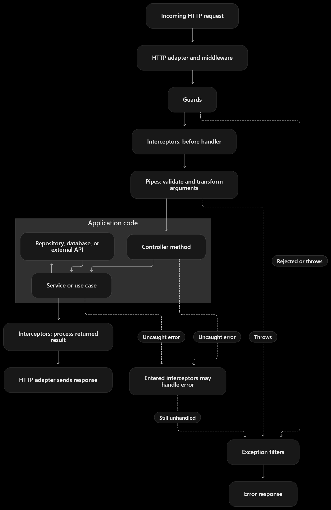

# TenantFlow Backend Engineering Conventions

Version 1.1 · Reviewed 18 October 2026 · NestJS backend · Proposed implementation baseline

[Documentation index](../README.md) · [Backend setup guide](../setup/NESTJS_BACKEND_SETUP.md) · [Backend requirements](../requirements/BACKEND_REQUIREMENTS.md)

## Purpose and scope

Use this guide when designing, implementing, reviewing, or modifying TenantFlow backend functionality. It defines shared conventions for human developers and AI agents so that request handling, business behavior, tenant isolation, and infrastructure integration remain consistent.

This revision has been checked against the repository's requirements and configuration. There is no backend implementation yet. NestJS is the selected framework; PostgreSQL 17 is configured for development, and the product direction is shared tables with tenant-scoped access. The existing frontend uses Stack Auth. ORM/migrations, API credential verification, provider-to-domain mappings, and deployment details remain decisions to record before implementing them. The [SRS](../requirements/TenantFlow-SRS.md) owns product rules and release boundaries; this guide owns engineering conventions.

**Authoring agreement:** You write every line of backend code. The assistant provides instructions, reviews, explanations, and feedback, and may maintain documentation. It must not scaffold, generate, patch, or auto-fix backend source, tests, migrations, dependencies, or runtime/build configuration unless you explicitly change that agreement. Commands and proposed structures in the setup guide are for you to execute and implement.

**Rule language:** MUST indicates a required convention. SHOULD indicates the default unless a concrete reason justifies an exception. MAY indicates an optional technique. Record material deviations and their rationale in the relevant change or architecture decision.

## Working principles

- MUST derive behavior from canonical product requirements and verified frontend integration needs. The previous backend has been retired; its old examples do not establish working API contracts to reproduce.
- SHOULD begin with a modular monolith organized by business capability. Add deployment boundaries only when operational requirements justify them.
- MUST give each concern a clear owner. HTTP handling belongs at the transport boundary; business rules belong in application services or domain logic; persistence belongs behind a deliberate data access boundary.
- SHOULD use Nest facilities and existing project conventions before introducing custom infrastructure.
- MUST apply runtime validation to untrusted inputs. TypeScript types alone provide no runtime protection.
- MUST enforce tenant isolation and business invariants at the boundaries where data is accessed or changed.
- SHOULD introduce abstractions only when they clarify responsibilities, protect a useful boundary, or enable meaningful substitution.

## Request lifecycle

The supplied diagram is a conceptual HTTP overview. Solid arrows show a typical successful request; dashed arrows show selected failure paths. Interceptors that have already been entered may recover a downstream error and return a response; otherwise an uncaught error reaches the applicable filter. The diagram omits some paths, including middleware failures, interceptor short-circuits, and errors thrown during response processing. Use the execution rules below for the precise boundaries.

**Normal HTTP path:** HTTP adapter and middleware → guards → inbound interceptors → pipes → controller method → application service or use case → data access or external systems → outbound interceptors → HTTP response.

The service and data access steps are application conventions, not mandatory Nest lifecycle stages. Modules organize dependencies; they are not stages through which requests travel.

**Execution rules**

- Middleware executes before guards. Guards execute before interceptors and pipes.
- Guards MUST treat route parameters, query values, and request bodies as unvalidated unless they validate the values they use themselves. Parameter pipes have not run yet.
- Guards generally run from global to controller to route scope. Interceptors enter in that order and unwind in reverse order.
- Pipes validate or transform individual handler arguments. Do not build logic around an assumed left-to-right order across method parameters.
- Interceptors wrap downstream execution. They MAY transform results, handle downstream errors, or short-circuit execution. An interceptor cannot observe a rejection that occurred before it was entered.
- Exception filters handle uncaught failures; they are not a mandatory step on the successful path. Method filters take precedence over controller filters, then global filters; a handled exception does not pass through every filter.
- Errors thrown by awaited application calls can propagate through entered interceptors and into filters. Detached background work requires its own error handling.
- Request access logging SHOULD begin early enough to capture middleware and guard rejections, not only successful controller execution.

## Responsibility placement

| Component | Owns | Example |
| --- | --- | --- |
| Middleware | Early HTTP preparation and request context initialization | Correlation ID and access logging |
| Guard | Authentication and authorization before handler execution | Verify actor and tenant membership |
| Pipe | Runtime validation and transformation of handler arguments | Validate DTO or parse UUID |
| Controller | HTTP routing and translation to application calls | Extract actor and input, call service |
| Service or use case | Business workflow, invariants, transaction coordination | Enforce plan limit and create project |
| Domain policy or entity | Business rules worth expressing independently | Whether a subscription allows an action |
| Repository or data adapter | Queries, persistence, tenant predicates | Update project within authorized tenant |
| Integration adapter | External service communication | Email, billing, or object storage client |
| Interceptor | Behavior around downstream execution and returned results | Timing, serialization, selected caching |
| Exception filter | Translate uncaught errors to a transport contract | Domain conflict to HTTP 409 |

Controllers SHOULD remain thin. They MUST NOT become the owner of database queries, transactions, or complex business workflows. Pipes SHOULD check input structure and value constraints; database-dependent business decisions belong in services or domain policies.

Authorization services SHOULD expose reusable policy logic when the same operation is invoked through HTTP, jobs, or other transports. A guard protects an HTTP entry point; it does not automatically protect a direct service call.

## Modules and dependency injection

Organize features by capability, such as identity, tenants, memberships, projects, billing, and notifications. These names illustrate possible boundaries; use actual product requirements to select modules.

- MUST register providers in their owning modules and export only the providers intended for other modules.
- MUST import the owning module to consume its exports. A TypeScript import alone does not register a dependency in Nest.
- SHOULD reuse exported providers rather than re-registering the same service in several modules.
- SHOULD use constructor injection for required dependencies. Avoid hidden dependency lookup and unnecessary global modules.
- MUST remember that a service is one kind of provider. Configuration values, repositories, SDK clients, and factories can also be providers.
- SHOULD use `useClass` for implementations, `useValue` for existing values or test doubles, `useFactory` for configured or asynchronous construction, and `useExisting` for aliases to the same provider.
- MUST use a runtime token, such as a shared Symbol or abstract class, when injecting a contract represented by a TypeScript interface. Interfaces are erased at runtime.
- SHOULD treat circular dependencies as a signal to review ownership before using `forwardRef()` as a workaround.

Global components needing injected dependencies SHOULD be registered through `APP_GUARD`, `APP_PIPE`, `APP_INTERCEPTOR`, or `APP_FILTER` as appropriate. Passing a manually constructed instance does not make Nest inject its constructor dependencies.

MUST register global authentication, tenant authorization, and permission enforcement in a deliberate order. A public-route exception needs explicit metadata and review. Global validation and error behavior MUST also be present in assembled HTTP tests; a testing module does not automatically execute `main.ts` bootstrap configuration.

Use dynamic modules when an integration needs configurable provider wiring. Methods such as `register()` and `forRootAsync()` are configuration patterns; they are not reasons to make every feature module dynamic.

## Provider lifetime and request context

| Scope | Meaning | Default usage |
| --- | --- | --- |
| Singleton | Shared instance for a provider registration | Stateless services and shared clients |
| Request | Instance tied to one incoming request | Dependencies that genuinely need request lifetime |
| Transient | Dedicated instance for each injecting consumer | Consumer-specific helper state |

SHOULD use singleton providers by default. Request scope can propagate to dependent consumers and increases per-request construction. Transient scope does not mean a new instance for every method call.

MUST NOT store the current actor, tenant, or transaction in mutable fields on singleton services. Concurrent requests can interleave even in a Node.js process.

Pass an explicit, typed application context when practical. MAY use correctly initialized AsyncLocalStorage for request metadata when explicit propagation becomes cumbersome. Context storage provides propagation, not authentication or authorization. Jobs MUST establish their own context rather than assuming an HTTP request context exists.

## Input and output contracts

- MUST validate every public input boundary, including HTTP requests, external events, and job payloads where applicable.
- SHOULD configure a deliberate global validation policy. For class-based DTO validation, a useful baseline is `transform: true`, `whitelist: true`, and `forbidNonWhitelisted: true`, backed by appropriate validation decorators.
- MUST explicitly define parsing and bounds for IDs, booleans, pagination, dates, and other ambiguous inputs. Avoid relying on broad implicit conversion.
- MUST assign trusted fields such as tenant identity and ownership from authorized server context. Do not allow unrestricted DTO spreading into persistence operations.
- SHOULD keep transport DTOs separate from database entities where their contracts differ.
- MUST return an explicit response contract. Map or serialize fields deliberately so password hashes, tokens, internal metadata, and unintended relations cannot escape.
- SHOULD use Nest-managed response handling. Use raw response objects only for concrete needs such as streaming, and account for effects on interceptors and serialization.
- MUST define stable status codes and error codes. Preserve useful client errors and keep internal exception details out of responses.

Decorators that attach metadata do not enforce behavior on their own. A permissions decorator MUST be paired with a guard or other component that reads and enforces it. Custom parameter decorators SHOULD extract context rather than hide database workflows.

Serialization decorators require the matching runtime interceptor and compatible returned instances. Plain ORM objects are not automatically safe because a DTO class exists. Explicit output mapping is a useful starting point. Document pagination limits, timestamps, error codes, and API versioning together with OpenAPI; API documentation does not replace runtime validation.

## Authentication and tenant isolation

Authentication establishes the actor. Tenant authorization establishes whether that actor may operate within the selected tenant. Resource authorization establishes whether the requested action on a particular resource is allowed.

- MUST verify tenant selection against authenticated identity and current authorization policy. A header, path segment, or body field is not proof of tenant membership.
- MUST scope tenant-owned reads, writes, deletes, joins, bulk operations, and exports to the authorized tenant. A resource ID alone is insufficient.
- MUST scope database constraints by tenant when uniqueness is tenant-specific. Use database isolation features where selected by the project design.
- MUST include tenant identity in tenant-specific cache keys, object storage paths, job payloads, and relevant audit records.
- MUST explicitly authorize cross-tenant administrative operations. Avoid hidden bypass flags in normal data access paths.
- MUST test cross-tenant access attempts and resource ID substitution, including update and delete paths.

Guards MAY reject unauthorized HTTP requests early, but data access MUST retain the required isolation predicates. Business invariants and isolation must also hold when application behavior is invoked by workers or scheduled tasks.

Credential verification MUST follow the chosen provider's supported protocol, including signature or session validity, expiry, intended audience/issuer where applicable, and the agreed revocation policy. Never treat decoding a token as verification. If authentication uses browser cookies, define CSRF protection, cookie attributes, and credentialed CORS together. A Nest authentication tutorial or package does not change Stack Auth ownership by itself.

## Persistence and reliable side effects

Application services SHOULD own the transaction boundary for a business operation. Data access components SHOULD accept or participate in that transaction according to the chosen database library. Do not assume that multiple injected repositories automatically share a transaction.

- MUST use database constraints, atomic operations, locking, or suitable transaction isolation where concurrency could violate an invariant.
- MUST NOT rely solely on a read-then-write check for limits or uniqueness under concurrent requests.
- SHOULD keep slow external network calls outside database transactions where possible.
- MUST manage schema changes through reviewed migrations. Destructive or incompatible migrations need a deliberate rollout strategy.
- SHOULD add a repository interface only when it protects a useful contract. Do not wrap every ORM method mechanically.

MUST prevent cross-tenant parent/child links and role assignments, using tenant-aware foreign keys or equivalent checks plus the required database constraints. Review query plans and bounded pagination for common tenant lookups. Automatic schema synchronization is not a production migration strategy.

PostgreSQL row-level security MAY add defense in depth after an explicit design decision. If used, establish tenant context per transaction, account for table-owner/bypass privileges, and prove that pooled connections cannot leak context between tenants. RLS does not replace application authorization.

Use in-process events for local decoupling where loss on process failure is acceptable. Use durable jobs for work that must survive restarts or run independently of the request. Configure retries, backoff, failure visibility, and idempotency according to the operation.

A database write and a queue enqueue are separate operations unless deliberately coordinated. MUST use an appropriate consistency strategy, such as a transactional outbox, when losing the side effect would violate business requirements. Queue delivery MUST NOT be treated as a guarantee of exactly-once business execution.

Provider webhooks MUST verify signatures over the provider-required raw payload before trusting events, and durably deduplicate delivery IDs. Acknowledge according to the provider's retry contract after durable acceptance or completed processing. Do not activate payments or notifications merely because the SDK can make a request.

## Configuration and operations

- MUST validate required configuration at startup and fail clearly when it is invalid. Keep secrets out of source control and logs.
- SHOULD construct infrastructure clients through providers so configuration, replacement, testing, and cleanup are centralized.
- MUST set explicit timeouts for external calls. Retry only where replay is safe or protected by idempotency.
- SHOULD configure security headers, CORS, body limits, and rate limits according to the deployment. CORS is not an authorization mechanism.
- MUST consider shared rate-limit state and trusted proxy configuration when running multiple instances behind a proxy.
- SHOULD use structured logs with request ID, operation, outcome, duration, and authorized tenant context where available. Do not log secrets or unrestricted request bodies.
- SHOULD distinguish process liveness from readiness to serve traffic. Configure shutdown hooks to close connections and stop workers gracefully.
- MUST keep CPU-intensive work from blocking the request-serving event loop; use suitable workers or background execution when needed.

Nest integrations reduce wiring effort. They do not choose the application's security, consistency, deployment, or recovery guarantees.

## Code organization and tooling

- SHOULD use feature modules under root `src/modules/`, with transport DTOs, application services, policies, and data access close to their feature. Export deliberate public providers instead of importing another module's private internals.
- SHOULD keep `src/common/` limited to small, reused transport concerns and put configuration/infrastructure wiring in their own modules. Avoid a catch-all shared service, generic base repository, or mandatory interface for every class.
- MUST enable TypeScript strict checking, keep promise/error handling explicit, and use the chosen module system consistently. Avoid disabling rules or adding `any` to bypass an unresolved contract.
- MUST limit root build, lint, format, and test globs to backend paths. The independent `frontend/` project and provisional root model files must not enter backend compilation accidentally.
- SHOULD retain generated tooling that fits the chosen Nest version, then define reproducible scripts and a root lockfile. Tool names and defaults can change across Nest releases; do not assume every generator uses the same lint or test runner.

## Testing and completion criteria

Use unit tests for meaningful business policies, integration tests for real persistence and transaction behavior, and HTTP tests for the assembled request pipeline. Provider overrides are useful at external boundaries; do not mock away the behavior a test intends to verify.

Before marking a backend change complete, verify the relevant items:

- [ ] Responsibilities follow the lifecycle and ownership conventions.
- [ ] Inputs are validated and response fields are deliberate.
- [ ] Authentication, permissions, and tenant isolation cover every entry path.
- [ ] Concurrency, transaction, and retry behavior match the business requirements.
- [ ] Dependencies, configuration, migrations, and failure handling are accounted for.
- [ ] Relevant tests, type checks, linting, and builds pass, or limitations are reported precisely.
- [ ] API documentation and affected architectural decisions are updated.
- [ ] No unrequested framework, database, or deployment change was introduced.

Tests SHOULD target observable risks and behavior. Avoid tests that merely mirror trivial implementation details or impose unnecessary work for low-impact edits.

## Instructions for AI agents

1. **Inspect before changing.** Read applicable repository instructions, package versions, module registration, configuration, existing tests, and the affected feature. Treat this guide as the intended baseline, not evidence of existing implementation.
2. **Identify the contract.** State the operation, entry points, trusted context, input and output contracts, tenant ownership, business invariants, and important failure cases.
3. **Place each concern.** Choose the appropriate middleware, guard, pipe, controller, service, data adapter, interceptor, or filter. Reuse existing components where they fit.
4. **Guide the smallest coherent change.** Explain responsibilities, implementation steps, and acceptance checks. The developer writes backend code and configuration. Do not introduce CQRS, microservices, a new ORM, or request scope by default.
5. **Review with evidence.** Inspect the developer's changes and identify concrete findings with file/line references, impact, and suggested corrections in prose. Run appropriate read-only checks when available; leave commands that write generated artifacts or apply fixes for the developer. Do not claim unexecuted tests passed.
6. **Report the result.** Explain reviewed behavior, checks actually performed, configuration or migration requirements, and unresolved risks. Separate verified facts from assumptions and recommendations.

Follow applicable system and user instructions, repository policies, and approved architecture decisions. If project instructions conflict with this guide, identify the conflict and follow the controlling instruction; document material deviations. Ask for clarification when an unresolved choice changes security, data ownership, externally visible contracts, or migration safety. Resolve routine implementation details using the existing project conventions.

## Decisions to confirm in the repository

The table distinguishes existing direction from decisions still needed. Recommendations in the setup guide become project decisions only when the developer records and implements them.

| Decision | What must be recorded |
| --- | --- |
| Framework and HTTP adapter | NestJS selected; exact supported version and Express or Fastify choice still needed |
| Application location and tooling | Backend at repository root beside `frontend/`; record Node/npm versions, module system, compiler/lint/test boundaries |
| Database and data library | PostgreSQL 17 development service exists; ORM/query builder and migration workflow still needed |
| Tenancy storage | Shared database with tenant IDs is the product direction; record constraints and any additional RLS decision |
| Authentication | Stack Auth is used by the frontend; backend verification, domain mappings, lifecycle ownership, and revocation policy still needed |
| Authorization | Membership, permissions, resource policy, and administrative access |
| API contracts | Versioning, response shape, error schema, pagination conventions |
| Background execution | Whether a durable queue is needed and its operational ownership |
| Deployment | Process topology, proxies, health checks, logs, and secret delivery |

## Official references

These links support the framework concepts discussed in this guide. Check documentation matching the installed Nest version before using version-sensitive APIs. Project rules above are engineering conventions, not claims that Nest automatically enforces them.

- [Request lifecycle](https://docs.nestjs.com/faq/request-lifecycle)
- [Modules](https://docs.nestjs.com/modules) and [custom providers](https://docs.nestjs.com/fundamentals/custom-providers)
- [Injection scopes](https://docs.nestjs.com/fundamentals/injection-scopes) and [AsyncLocalStorage](https://docs.nestjs.com/recipes/async-local-storage)
- [Guards](https://docs.nestjs.com/guards), [interceptors](https://docs.nestjs.com/interceptors), and [exception filters](https://docs.nestjs.com/exception-filters)
- [Validation](https://docs.nestjs.com/techniques/validation) and [authorization](https://docs.nestjs.com/security/authorization)
- [CSRF protection](https://docs.nestjs.com/security/csrf) and [raw webhook bodies](https://docs.nestjs.com/faq/raw-body)
- [PostgreSQL 17 constraints](https://www.postgresql.org/docs/17/ddl-constraints.html) and [row security policies](https://www.postgresql.org/docs/17/ddl-rowsecurity.html)
- [Configuration](https://docs.nestjs.com/techniques/configuration), [queues](https://docs.nestjs.com/techniques/queues), and [testing](https://docs.nestjs.com/fundamentals/testing)
