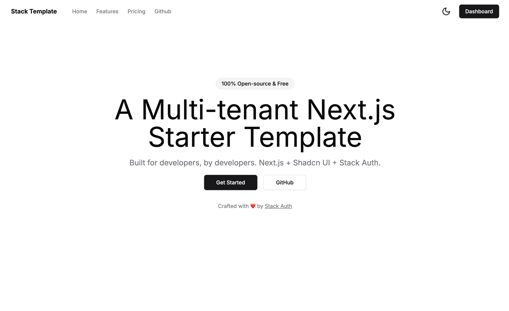
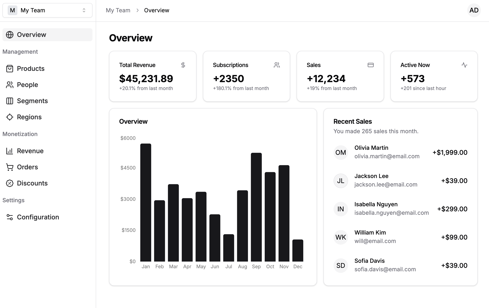
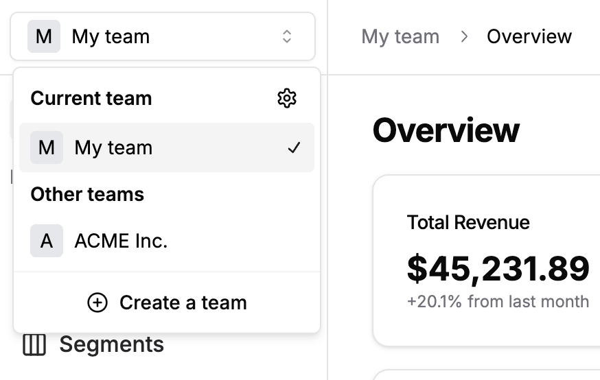
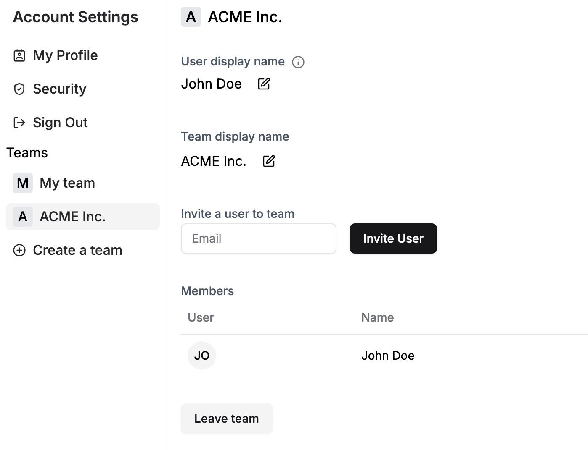

# TenantFlow Frontend Starter

A minimalistic multi-tenant Next.js starter template with minimal setup and a modular design. Bring your own backend and database.

This directory preserves the Stack Auth starter while the TenantFlow backend restarts from requirements for NestJS. Business APIs are absent; dashboard metrics and placeholder routes are demo content. Follow the root [START_HERE](../docs/setup/START_HERE.md) for repository onboarding and [backend requirements](../docs/init/BACKEND_REQUIREMENTS.md) for the planned backend.

[Demo](https://stack-template.vercel.app/)

## Landing Page

<div align="center">

</div>

## Dashboard

<div align="center">

</div>

## Multi-tenancy (Teams)

<div align="center">

</div>

## Account Settings

<div align="center">

</div>

## Getting Started

1. Clone TenantFlow and enter its frontend directory (use Node.js 22 and npm, matching existing CI)

    ```bash
    git clone https://github.com/thienan2003bt/TenantFlow.git
    cd TenantFlow/frontend
    ```

2. Install dependencies

    ```bash
    npm ci
    ```

3. Register an account on [Stack Auth](https://stack-auth.com), copy the keys from the dashboard, and paste them into the `.env.local` file. Then, enable "client team creation" on the team settings tab.

    Start from `.env.local.example`. The `STACK_SECRET_SERVER_KEY` is server-private; only the two `NEXT_PUBLIC_` settings are browser-public. See the [environment guide](../docs/setup/ENV_AND_GITIGNORE_SETUP.md) for file locations and the container build limitation.

    If you want to learn more about Stack Auth or self-host it, check out the [Docs](https://docs.stack-auth.com) and [GitHub](https://github.com/stack-auth/stack).

4. Start the development server and go to [http://localhost:3000](http://localhost:3000)

    ```bash
    npm run dev
    ```

## Features & Tech Stack

- Next.js 15.1.11 app router and React 19 (current package manifest)
- TypeScript
- Tailwind & Shadcn UI
- Stack Auth
- Multi-tenancy (teams/orgs)
- Dark mode

## Inspired by

Derived from the [Stack Auth multi-tenant starter](https://github.com/stack-auth/stack-template). Original assets and the [license](LICENSE) are retained.

- [Shadcn UI](https://github.com/shadcn-ui/ui)
- [Shadcn Taxonomy](https://github.com/shadcn-ui/taxonomy)
